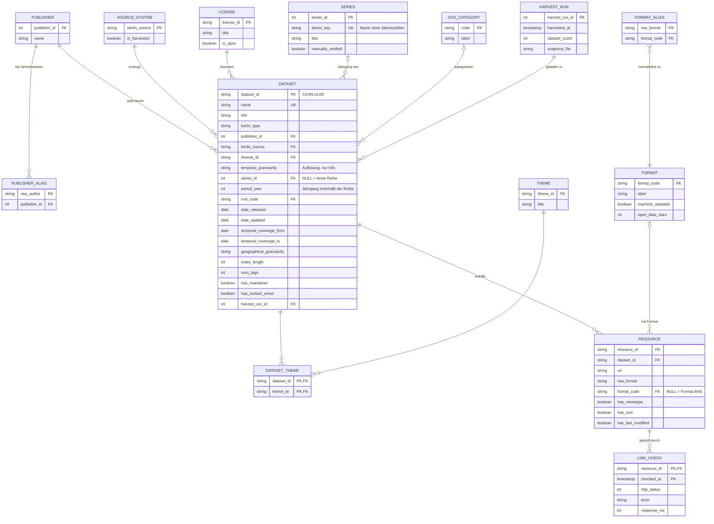

# ER-Modell (Entwurf, Ticket 2.1)

Entwurf in 3NF. Personendaten (`maintainer`, `maintainer_email`) werden **nicht** gespeichert, nur als Ja/Nein-Flag. Schlagwörter speichern wir nur als Anzahl (`num_tags`), um Tabellen zu sparen.

## Begründungen für die Präsentation

- **`publisher` + `publisher_alias`**: `author` ist Freitext mit Tippfehlern. Ohne Alias-Tabelle würde eine Behörde mehrfach gezählt (Normalisierung gegen Redundanz und Anomalien).
- **`format` + `format_alias`**: 52 Schreibweisen werden auf wenige echte Formate abgebildet. Maschinenlesbarkeit steht genau einmal pro Format (3NF statt pro Ressource wiederholt).
- **`series`**: Zeitreihen sind über viele Datensätze verteilt. Die Reihe ist ein eigenes Objekt. Die Zuordnung erfolgt per Heuristik und wird von Hand nachgeprüft (`manually_verified`).
- **`dataset_theme`**: Ein Datensatz kann mehreren Themen angehören (n:m) und braucht deshalb eine Zwischentabelle.
- **Keine Personendaten**: nur Flags, keine Namen oder Mail-Adressen.
- **Delta-Tabellen in Databricks** erzwingen keine Fremdschlüssel. PK und FK werden als *informational constraints* deklariert, und der Import prüft die Integrität (z. B. kein `format_code`, der nicht in `format` steht).

## Offene Fragen

- [ ] `hvd_category`-Codes (z. B. `c_dd313021`) auf Klartext abbilden, über das EU-Vokabular „High-value dataset categories“ prüfen.
- [x] Datensätze mit `berlin_type` = `dokument` oder `app` (37 Stück) werden ausgeschlossen.
